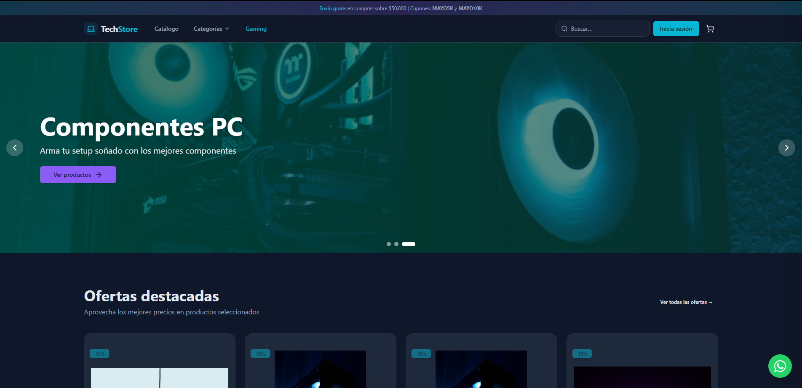
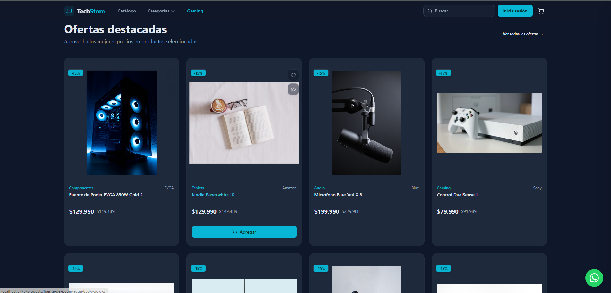
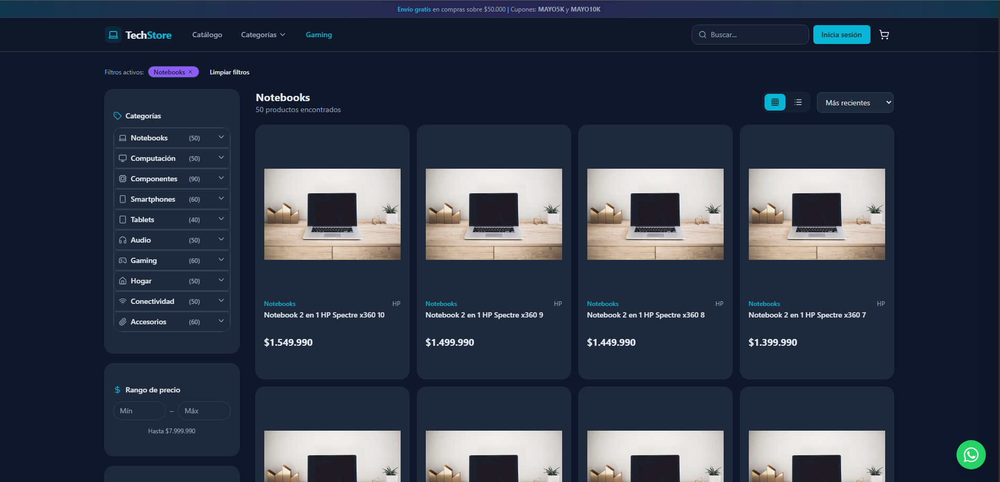
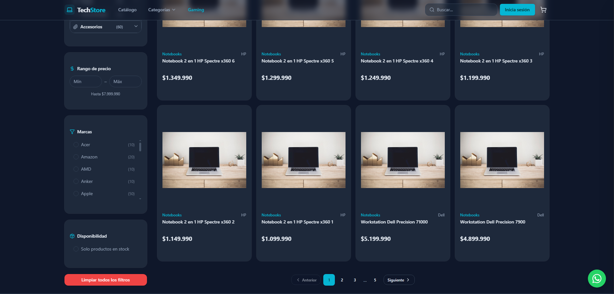
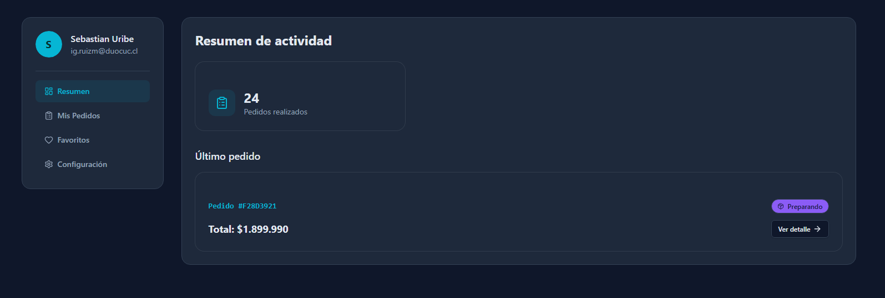
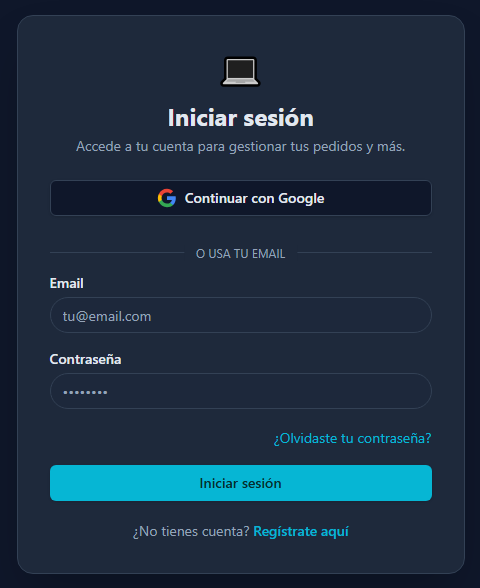
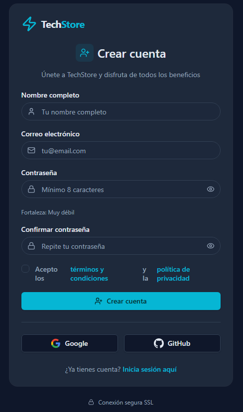

#  TechStore - E-Commerce MERN Platform


TechStore es una plataforma de comercio electrónico integral y escalable, desarrollada desde cero utilizando la pila tecnológica **MERN**. Diseñada con un enfoque "Mobile-First" y arquitectura orientada a servicios, la aplicación ofrece una experiencia de usuario optimizada, pasarela de pagos integrada y un ecosistema de gestión administrativa completo.

---

##  Propuesta de Valor y Características

###  Experiencia del Cliente (B2C)
* **Catálogo Inteligente:** Filtrado multi-criterio, buscador predictivo y paginación optimizada.
* **Carrito de Compras:** Gestión de estado global, persistencia de datos y validador de cupones de descuento en tiempo real.
* **Checkout Seguro:** Integración oficial de **Transbank Webpay Plus (REST API)** para transacciones financieras fiables.
* **Sistema de Notificaciones:** 
    * **Email:** Envío automatizado para confirmación de pedidos, validación de registro y recuperación de contraseñas.
    * **In-App:** Centro de notificaciones para estados de pedidos y alertas de sistema.
* **Portal de Usuario:** Gestión de perfil, direcciones, lista de deseos (Wishlist) y trazabilidad completa de pedidos mediante un *timeline* logístico.

###  Panel de Administración (B2B)
* **Dashboard Analítico:** Visualización de KPIs, ventas mensuales y métricas de crecimiento mediante gráficos interactivos.
* **Gestión de Inventario (CRUD):** Administración total de productos con soporte para subida de imágenes (Middleware Multer) y control de stock en tiempo real.
* **Logística y Procesos:** Interfaz avanzada para la actualización de estados de órdenes de compra.
* **Gestión de Usuarios:** Control de roles, permisos y administración de perfiles de clientes.
* **Motor de Marketing:** Creación y gestión de cupones promocionales con lógica de validación.

---

##  Funciones de Ingeniería y Seguridad
* **Seguridad de Nivel Empresarial:** Implementación de JWT (JSON Web Tokens) para sesiones sin estado y encriptación de contraseñas con Bcrypt.js.
* **Rutas Protegidas:** Sistema de *PrivateRoutes* con verificación de permisos basada en roles (Admin/User).
* **UI/UX Adaptativa:** Implementación de Skeleton Loaders, estados de error, estados vacíos y feedback visual (Toasts).
* **Validación de Datos:** Sanitización de inputs y validación de esquemas para evitar inyecciones.
* **Patrón de Diseño:** Implementación de arquitectura MVC (Model-View-Controller) para una escalabilidad óptima.

---

##  Interfaz de Usuario y Flujos

### 1. Inicio y Catálogo de Productos
| Landing Page | Categorías Dinámicas |
| :---: | :---: |
|  |  |
| **Grid de Catálogo** | **Filtros Avanzados** |
|  |  |
| **Vista de Producto (Top)** | **Detalle de Producto (Bottom)** |
|  |  |

### 2. E-Commerce: Carrito y Webpay
| Carrito Lateral (Drawer) | Vista de Carrito Completa |
| :---: | :---: |
|  |  |
| **Resumen y Checkout** | **Pasarela de Pago (Webpay)** |
|  |  |

### 3. Portal de Usuario y Seguridad
| Login y Autenticación | Registro de Cuenta |
| :---: | :---: |
|  |  |
| **Dashboard de Usuario** | **Ajustes de Perfil** |
|  |  |
| **Historial de Pedidos** | **Tracking Logístico** |
|  |  |
| **Lista de Deseos (Wishlist)** | **Centro de Notificaciones** |
|  |  |

### 4. Back-Office: Panel de Administración
| Dashboard Principal | Analítica Mensual |
| :---: | :---: |
|  |  |
| **Inventario de Productos** | **Formulario de Carga (Multer)** |
|  |  |
| **Gestión de Órdenes** | **Administración de Clientes** |
|  |  |
| **Monitor de Cupones** | **Generador de Descuentos** |
|  |  |

---

##  Instalación y Despliegue Local

### 1. Requisitos previos
* [Node.js](https://nodejs.org/) (v16+)
* [MongoDB](https://www.mongodb.com/) (Local o Atlas)

### 2. Clonar el repositorio
```bash
git clone [https://github.com/IgnacioRuizMcode/techstore.git](https://github.com/IgnacioRuizMcode/techstore.git)
cd techstore 

### 3. Configuración de Variables de Entorno
Crea un archivo .env dentro de la carpeta server/ con:
